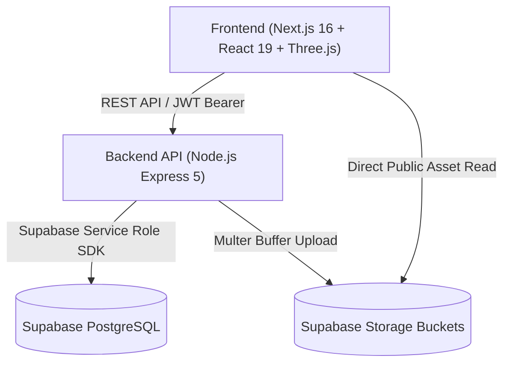
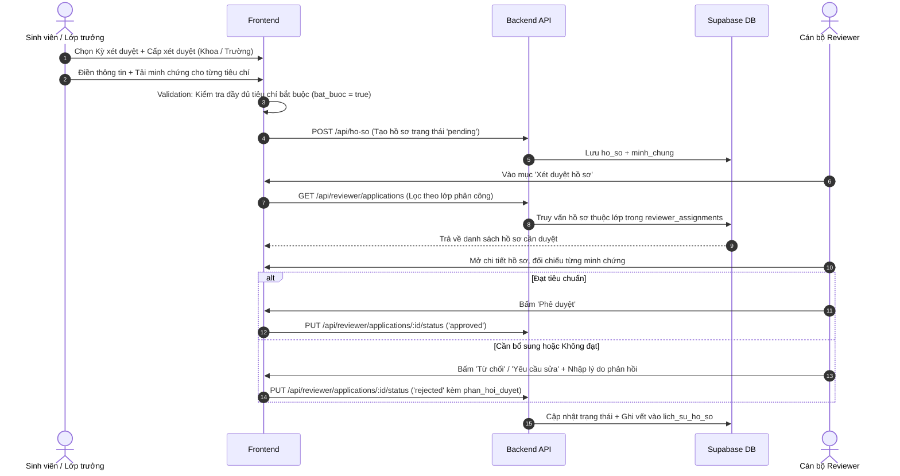
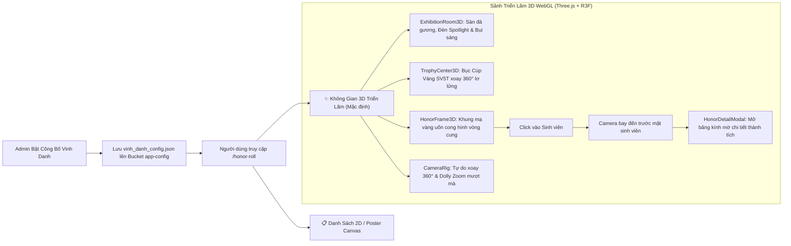

# 🎓 Hệ thống Quản lý Sinh viên 5 Tốt & Tập thể Tiên tiến

> **Dự án:** Quản lý quy trình đăng ký, xét duyệt danh hiệu "Sinh viên 5 Tốt", "Tập thể Tiên tiến", tích hợp Hồ sơ điện tử (E-Profile), Quản lý Sự kiện gắn tiêu chí, và Không gian Triển lãm Vinh danh 3D (3D Virtual Hall of Fame).  
> **Phiên bản:** 2.0 (Cập nhật: 20/10/2026)  
> **Kho mã nguồn:** [GitHub - QuanNguyen2209/DoAnCoSo_QuanLySV5T_TTTT](https://github.com/QuanNguyen2209/DoAnCoSo_QuanLySV5T_TTTT)

---

## 📑 Mục lục
1. [Kiến trúc & Công nghệ (Tech Stack)](#1-kiến-trúc--công-nghệ-tech-stack)
2. [Vai trò & Phân quyền (Roles & Permissions)](#2-vai-trò--phân-quyền-roles--permissions)
3. [Luồng Nghiệp vụ Cốt lõi (Core Business Flows)](#3-luồng-nghiệp-vụ-cốt-lõi-core-business-flows)
4. [Cấu trúc Thư mục Dự án (Project Structure)](#4-cấu-trúc-thư-mục-dự-án-project-structure)
5. [Cơ sở Dữ liệu & Storage (Database & Storage)](#5-cơ-sở-dữ-liệu--storage-database--storage)
6. [Tài khoản Kiểm thử & Kịch bản Test](#6-tài-khoản-kiểm-thử--kịch-bản-test)
7. [Hướng dẫn Khởi chạy (Getting Started)](#7-hướng-dẫn-khởi-chạy-getting-started)
8. [Chỉ dẫn Dành cho AI Agents (Guidelines for AI Agents)](#8-chỉ-dẫn-dành-cho-ai-agents-guidelines-for-ai-agents)

---

## 1. 🛠️ Kiến trúc & Công nghệ (Tech Stack)

Hệ thống được tổ chức theo mô hình **Monorepo / Decoupled Client-Server**:



### 💻 Frontend (`/frontend`)
- **Core:** Next.js 16 (App Router, Turbopack), React 19, TypeScript.
- **Styling & UI:** Tailwind CSS, Framer Motion (hiệu ứng micro-interactions), Lucide React (icon set).
- **3D Graphics & WebGL:** Three.js, `@react-three/fiber`, `@react-three/drei`, `maath`.
- **State & Networking:** Zustand (`authStore.ts`), Axios instance với tự động inject JWT Token (`src/lib/axios.ts`).

### ⚙️ Backend (`/backend`)
- **Core:** Node.js, Express 5.
- **Database Connector:** `@supabase/supabase-js` (Service Role Key).
- **Authentication:** `jsonwebtoken` (JWT), `bcryptjs` (hash mật khẩu an toàn).
- **File Handling:** `multer` (xử lý bộ nhớ RAM buffer cho file tải lên và đẩy trực tiếp lên Supabase Storage).
- **Utilities:** `pdfkit` (xuất phiếu chứng nhận / hồ sơ chuẩn mẫu logo HUTECH, Đoàn, Hội), `nodemailer` (gửi mã OTP quên mật khẩu).

---

## 2. 👥 Vai trò & Phân quyền (Roles & Permissions)

Hệ thống hỗ trợ 4 nhóm vai trò người dùng được định nghĩa qua trường `role` trong bảng `users`:

| Vai trò (`role`) | Tên hiển thị | Quyền hạn chính |
|---|---|---|
| `sinh_vien` | **Sinh viên** | Quản lý Hồ sơ điện tử (E-Profile); Nộp hồ sơ SV5T cá nhân; Tải minh chứng; Xem tiến độ xét duyệt; Khám phá & Đăng ký sự kiện; Tham quan Không gian Vinh danh 3D & Tải poster cá nhân. |
| `lop_truong` | **Lớp trưởng** | Toàn bộ quyền của sinh viên + Quyền nộp hồ sơ xét duyệt **Tập thể Tiên tiến** đại diện cho lớp; Theo dõi tổng quan phong trào lớp. |
| `can_bo` | **Cán bộ Đoàn - Hội** | Xét duyệt hồ sơ theo danh sách Lớp/Khoa được phân công (`reviewer_assignments`); Kiểm tra và xác thực minh chứng; Phê duyệt (`approved`), từ chối (`rejected`) hoặc yêu cầu bổ sung; Thống kê số lượng hồ sơ đơn vị phụ trách. |
| `admin` | **Quản trị viên** | Toàn quyền hệ thống: Quản lý Kỳ xét duyệt; Cấu hình Tiêu chí (tiêu chí SV5T / Tập thể, tiêu chí bắt buộc); Quản lý Khoa & Lớp; Phân công cán bộ xét duyệt; Quản lý Sự kiện (upload banner, gắn tiêu chí); Quản lý Bảng vinh danh (bật/tắt công bố, upload mẫu poster, quản trị 3D); Báo cáo thống kê toàn trường. |

---

## 3. 🔄 Luồng Nghiệp vụ Cốt lõi (Core Business Flows)

### 📌 Luồng 1: Xác thực & Hồ sơ điện tử (Auth & E-Profile)
1. **Đăng nhập / Đăng ký:** Sinh viên đăng nhập bằng email trường / mã sinh viên. Backend sinh mã JWT token chứa thông tin định danh và vai trò.
2. **Quên mật khẩu:** Sinh viên nhập email → Backend xác thực tài khoản và gửi mã xác nhận OTP 6 số qua Google SMTP (`nodemailer`) → Xác nhận mã và đổi mật khẩu mới.
3. **Hồ sơ điện tử (E-Profile):** Sinh viên hoàn thiện 5 khối thông tin cốt lõi:
   - *Thông tin cá nhân & Liên hệ* (họ tên, ngày sinh, giới tính, CCCD, điện thoại, email, địa chỉ).
   - *Thông tin Đào tạo* (Khoa, Lớp, MSSV, Khóa học, Điểm GPA, Điểm rèn luyện).
   - *Thông tin Đoàn - Đảng* (ngày vào Đoàn, ngày vào Đảng, chức vụ đoàn thể).
   - *Thông tin Việc làm & Kỹ năng* (công việc hiện tại, nơi làm việc, kỹ năng mềm, chứng chỉ).

---

### 📌 Luồng 2: Đăng ký & Xét duyệt SV5T / Tập thể Tiên tiến


---

### 📌 Luồng 3: Quản lý Sự kiện & Chứng nhận Tiêu chí (Events & Criteria Binding)
1. **Admin tạo sự kiện:**
   - Admin vào `/admin/events` → Bấm **"Tạo sự kiện mới"**.
   - Nhập tiêu đề, ngày diễn ra, địa điểm, sức chứa tối đa.
   - **Upload Banner từ máy tính:** File ảnh được gửi qua `multipart/form-data` lên backend, multer tiếp nhận buffer và upload trực tiếp lên bucket `events` trên Supabase Storage. (Chức năng nhập URL thủ công đã được loại bỏ hoàn toàn).
   - **Đính kèm Tiêu chí:** Chọn các tiêu chí Sinh viên 5 Tốt và Tập thể tiên tiến mà sự kiện hỗ trợ. Lưu vào mảng `events.criteria_ids`.
2. **Sinh viên tham gia:**
   - Sinh viên vào `/student/events` → Xem các sự kiện đang mở, xem các tiêu chí được chứng nhận khi tham gia.
   - Bấm **"Đăng ký tham gia"** để giữ chỗ và ghi nhận tham gia phong trào.

---

### 📌 Luồng 4: Vinh Danh & Không Gian 3D Triển Lãm (3D Virtual Hall of Fame)


---

## 4. 📁 Cấu trúc Thư mục Dự án (Project Structure)

```text
DoAnCoSo_QuanLySV5T_TTTT/
├── DACS/
│   ├── backend/                     # Backend RESTful API (Express 5)
│   │   ├── config/
│   │   │   └── db.js                # Kết nối Supabase Service Role client
│   │   ├── controllers/             # Xử lý logic nghiệp vụ
│   │   │   ├── authController.js    # Đăng nhập, đăng ký, OTP quên mật khẩu
│   │   │   ├── eventController.js   # CRUD sự kiện, upload banner, đính kèm tiêu chí
│   │   │   ├── hoSoController.js    # Quản lý hồ sơ, nộp minh chứng
│   │   │   ├── reviewerController.js# Phân công xét duyệt, duyệt hồ sơ cán bộ
│   │   │   ├── vinhDanhController.js# Thống kê vinh danh, config công bố, poster template
│   │   │   └── pdfController.js     # Xuất giấy chứng nhận PDF chuẩn mẫu
│   │   ├── routes/                  # Định nghĩa endpoints Express
│   │   ├── middleware/              # JWT Auth middleware, multer upload
│   │   ├── seed_honor_data.js       # Script khởi tạo 7 SV tiêu biểu và hồ sơ mẫu vinh danh
│   │   └── server.js                # Server entry point
│   │
│   ├── frontend/                    # Frontend Web App (Next.js 16 + R3F)
│   │   ├── src/
│   │   │   ├── app/                 # Next.js App Router
│   │   │   │   ├── (auth)/          # Trang đăng nhập, đăng ký, quên mật khẩu
│   │   │   │   ├── (dashboard)/     # Layout Dashboard dùng chung
│   │   │   │   │   ├── admin/       # Phân hệ Admin (events, criteria, periods, classes, statistics)
│   │   │   │   │   ├── reviewer/    # Phân hệ Cán bộ (applications, statistics)
│   │   │   │   │   ├── student/     # Phân hệ Sinh viên (profile, register, records, events)
│   │   │   │   │   └── honor-roll/  # Trang Bảng Vinh Danh (tích hợp Không gian 3D)
│   │   │   │   └── layout.tsx
│   │   │   ├── components/
│   │   │   │   ├── honor3d/         # Toàn bộ module Không gian Triển lãm 3D
│   │   │   │   │   ├── Honor3DGallery.tsx    # Master Canvas, HUD tìm kiếm & bộ đếm
│   │   │   │   │   ├── ExhibitionRoom3D.tsx  # Sàn đá phản chiếu gương, đèn & bụi sáng
│   │   │   │   │   ├── TrophyCenter3D.tsx    # Cúp vàng SV5T 3D xoay 360° lơ lửng
│   │   │   │   │   ├── HonorFrame3D.tsx      # Khung chân dung mạ vàng & fallback canvas
│   │   │   │   │   ├── CameraRig.tsx         # Điều khiển OrbitControls & Dolly Zoom
│   │   │   │   │   └── HonorDetailModal.tsx  # Modal kính mờ Glassmorphism chi tiết SV
│   │   │   │   └── layout/          # Sidebar, Header, Mobile Nav
│   │   │   ├── lib/                 # authStore.ts (Zustand), axios.ts
│   │   │   └── services/            # API client wrappers (eventService.ts, ...)
│   │
│   ├── database/                    # Các kịch bản SQL Supabase
│   │   ├── supabase_schema.sql      # Schema gốc đầy đủ của hệ thống
│   │   ├── add_events.sql           # Schema bảng sự kiện ban đầu
│   │   ├── update_events_image_criteria.sql # Cập nhật image_url và criteria_ids
│   │   └── add_collective_criteria.sql      # Bộ tiêu chuẩn cho Tập thể tiên tiến
│   │
│   └── docs/                        # Tài liệu dự án
│       ├── architecture-and-db.md   # Thiết kế kiến trúc & cơ sở dữ liệu
│       ├── test-scenarios.md        # Kịch bản kiểm thử chi tiết từng vai trò
│       └── daily-logs/              # Nhật ký tiến độ phát triển theo ngày
```

---

## 5. 🗄️ Cơ sở Dữ liệu & Storage (Database & Storage)

### Các bảng chính (PostgreSQL trên Supabase)
1. `users`: Tài khoản người dùng (`id, email, password_hash, ho_ten, ma_sv, role, avatar_url, lop_id`).
2. `user_profiles`: Thông tin hồ sơ điện tử mở rộng (CCCD, địa chỉ, GPA, ĐRL, việc làm, Đoàn-Đảng).
3. `khoa` & `lop_hoc`: Danh mục khoa viện và lớp chuyên ngành.
4. `ky_xet_duyet`: Các kỳ xét duyệt danh hiệu (năm học, thời hạn nộp, trạng thái `active`/`closed`).
5. `tieu_chi`: Danh mục tiêu chuẩn SV5T và Tập thể (`bat_buoc`, điểm yêu cầu, tiêu chí cha/con).
6. `ho_so`: Hồ sơ đăng ký (`ma_ho_so, sinh_vien_id, ky_xet_duyet_id, loai_doi_tuong, trang_thai, cap_xet_duyet`).
7. `minh_chung`: Minh chứng thành tích cho từng tiêu chí (`ho_so_id, tieu_chi_id, ten_thanh_tich, cap_thanh_tich`).
8. `reviewer_assignments`: Phân công cán bộ phụ trách lớp (`reviewer_id, lop_id`).
9. `events`: Quản lý sự kiện (`id, title, description, start_time, location, max_participants, image_url, criteria_ids`).

### Các Bucket trên Supabase Storage
- `events`: Lưu trữ ảnh banner sự kiện tải lên trực tiếp từ máy tính.
- `app-config`: Lưu tệp cấu hình hệ thống (`vinh_danh_config.json`).
- `poster-templates`: Lưu ảnh mẫu poster vinh danh do Admin tải lên.
- `avatars`: Ảnh đại diện của người dùng.
- `minh-chung`: Các tệp đính kèm chứng nhận/giấy khen do sinh viên tải lên.

---

## 6. 🧪 Tài khoản Kiểm thử & Kịch bản Test

| Vai trò | Họ tên | Email đăng nhập | Mật khẩu mặc định | Ghi chú |
|---|---|---|---|---|
| **Admin** | Admin Test | `admin@test.edu.vn` | `Test1234@` | Toàn quyền cấu hình, sự kiện & vinh danh |
| **Cán bộ** | Cán bộ Test | `canbo@test.edu.vn` | `Test1234@` | Phụ trách duyệt hồ sơ các lớp CNTT |
| **Sinh viên** | Sinh Vien Test | `sinhvien@test.edu.vn` | `Test1234@` | Sinh viên tiêu biểu lớp CNTT K22A |
| **Chủ dự án** | Nguyễn Lê Nguyên Quân | `nguyenlebaoquan1404@gmail.com` | `Quan2209@` | ⭐ 2x Lần Vinh Danh SV5T |

*(Xem thêm các kịch bản kiểm thử từng bước tại [`docs/test-scenarios.md`](file:///c:/DoAnCoSo_QuanLySV5T_TTTT/DACS/docs/test-scenarios.md))*

---

## 7. 🚀 Hướng dẫn Khởi chạy (Getting Started)

### Yêu cầu môi trường
- **Node.js**: v20.x hoặc v24.x LTS.
- **Trình quản lý gói**: `npm` v10+.
- **Tài khoản Supabase**: Đã tạo Project và có URL + Service Role Key.

### 1. Khởi chạy Backend
```bash
cd DACS/backend
npm install
# Cấu hình file .env:
# PORT=5000
# SUPABASE_URL=https://<your-project>.supabase.co
# SUPABASE_SERVICE_ROLE_KEY=<your-service-role-key>
# JWT_SECRET=<your-jwt-secret>
npm run dev
```
*Backend lắng nghe tại: `http://localhost:5000`*

### 2. Khởi chạy Frontend
```bash
cd DACS/frontend
npm install
npm run dev
```
*Frontend ứng dụng hoạt động tại: `http://localhost:3000`*

### 3. Tạo dữ liệu mẫu Vinh danh 3D (Tùy chọn)
Nếu muốn nạp ngay 7 sinh viên tiêu biểu với 45 minh chứng vào không gian 3D:
```bash
cd DACS/backend
node seed_honor_data.js
```

---

## 8. 🤖 Chỉ dẫn Dành cho AI Agents (Guidelines for AI Agents)

Khi tiếp quản và phát triển dự án này trong các phiên làm việc tiếp theo, AI Agents cần tuân thủ các nguyên tắc sau:

1. **Next.js & WebGL Dynamic Import:**
   - Các component 3D Three.js / React Three Fiber **bắt buộc** phải được nạp thông qua `next/dynamic` với `{ ssr: false }` khi dùng trong Next.js App Router nhằm tránh lỗi `window is not defined` hoặc crash WebGL context trong quá trình SSR.
2. **Xử lý Tải File & Upload Ảnh:**
   - Không lưu trữ file cục bộ trên đĩa máy chủ. Luôn sử dụng `multer` memory storage và upload buffer trực tiếp lên **Supabase Storage** bằng Service Role client.
   - Khi upload banner sự kiện hoặc poster, chỉ chấp nhận upload từ máy tính (không mở lại chức năng nhập URL thủ công theo quyết định kiến trúc).
3. **Tính Toàn vẹn Dữ liệu (Constraints):**
   - Bảng `ho_so`: `cap_xet_duyet` chỉ nhận các giá trị `'khoa'` hoặc `'truong'`.
   - Bảng `minh_chung`: `cap_thanh_tich` chỉ nhận các giá trị `'truong'`, `'khoa'`, hoặc `'khac'`.
4. **Nhật ký Phát triển (Daily Logs):**
   - Mỗi phiên làm việc hoàn thành tính năng lớn, luôn tạo tệp nhật ký mới trong thư mục `docs/daily-logs/YYYY-MM-DD.md` và cập nhật đường dẫn vào `docs/daily-logs/README.md`.
